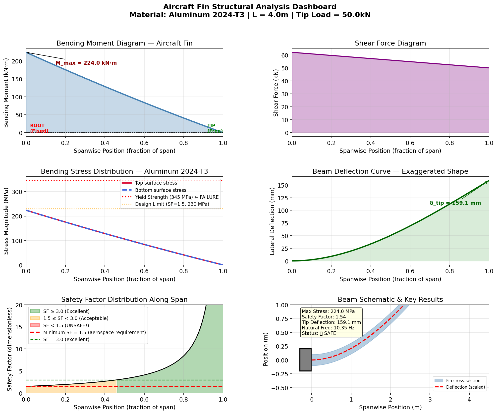
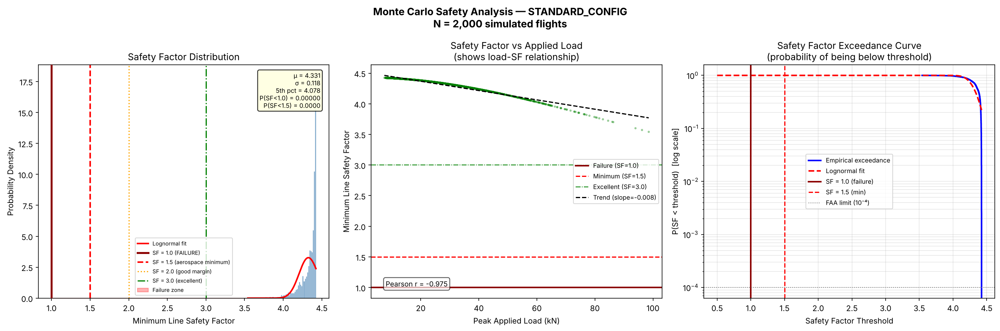
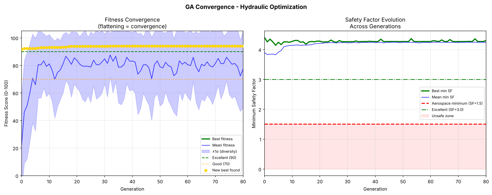
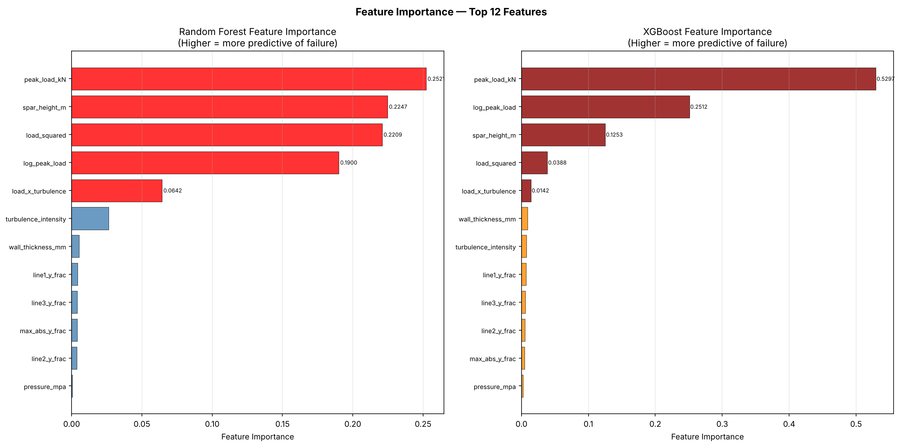

# AI-Assisted Aircraft Hydraulic Safety Optimization System
## Live Demo
🚀 **[Try the live dashboard](https://aircraft-hydraulic-safety-ayman.streamlit.app/)**


A complete AI-assisted engineering simulation system for optimizing
hydraulic line placement in aircraft fin structures. Combines classical
aerospace engineering physics with modern AI techniques including
Monte Carlo simulation, genetic algorithms, and machine learning.

---

## Project Overview

Aircraft hydraulic lines carry flight-critical fluid under high pressure
(3000-5000 PSI). Their placement inside the fin structure critically
affects both their structural safety (bending stress from aerodynamic
loads) and system reliability (redundancy, separation, overlap).

This project builds a complete simulation and optimization pipeline:
Flight Loads → Structural Analysis → Hydraulic Safety Evaluation
↓               ↓                        ↓
Monte Carlo    Genetic Algorithm         ML Failure Prediction
Simulation      Optimization              (Real-time Dashboard)

---

## Key Results

All numbers below come from re-running the code (`python main.py all`, seeds fixed).

| Phase | Result |
|-------|--------|
| Structural | 4 m fin, Al 2024-T3, 50 kN tip + 3 kN/m distributed load: max stress 224 MPa, SF = 1.54, tip deflection 159 mm |
| Hydraulic | Tube stresses use Lamé thick-wall equations and full 3-D Von Mises. Standard layout score 90.3/100; dangerous layout 0.0 (tubes overlap) |
| Monte Carlo | 2,000 flights, P(failure) = 0.001 for the standard layout; severe turbulence is the only scenario that fails (2.7% of those flights) |
| Data science | Peak load vs lowest tube SF: Pearson r = -0.85; failures begin above 96.2 kN |
| Genetic algorithm | Score 90.3 -> 94.1/100. Ablation over 10 seeds: removing the position term drops the mean minimum tube SF from 4.24 to 3.80 (`python -m optimization.ablation`) |
| Machine learning | Leak-free, group-split model on 20,000 simulated flights. Test AUC 0.9997 (RF) / 0.9998 (XGBoost), but a one-line physics rule (load / spar height^2) scores as well or better. ML is a surrogate, not a discovery |
| Dashboard | Streamlit app with presets, a verdict banner, tube SF vs position chart, and an ML tab that uses the real inputs |

## Screenshots

### Streamlit Dashboard


### Monte Carlo Results


### Genetic Algorithm Convergence


### ML Feature Importance


## System Architecture
core/
├── material.py          Material database (Al 2024-T3, Ti-6Al-4V...)
├── beam.py              Euler-Bernoulli cantilever beam physics
├── stress_calculator.py Bending stress, safe zone analysis
├── hydraulic_line.py    Hoop stress, Von Mises, Basquin fatigue
└── hydraulic_configuration.py  Multi-line safety scoring
simulation/
├── wind_model.py        ISA atmosphere, Gauss-Markov turbulence
├── flight_conditions.py 7 flight scenarios (cruise, maneuver, storm...)
└── monte_carlo.py       Full Monte Carlo engine, CSV export
optimization/
└── genetic_optimizer.py Population=50, Generations=80, Tournament selection
ml/
├── dataset_builder.py   Feature engineering, correlation analysis
├── features.py          Single source of truth for model features + leakage guard
├── generate_dataset.py  Independent, seeded simulated flights
└── train_model.py       RF + XGBoost + logistic regression + baselines, calibration
visualization/
├── stress_plots.py      Engineering dashboard plots
├── beam_animation.py    60-frame GIF animations
├── interactive_plots.py Plotly 3D HTML visualizations
├── ga_plots.py          Convergence and diversity plots
└── ml_plots.py          ROC curves, confusion matrices, landscapes
dashboard/
└── app.py               Streamlit web application

---

## How to Run

### Setup
```bash
git clone https://github.com/aymanchamp-sudo/aircraft-hydraulic-safety
cd aircraft-hydraulic-safety
pip install -r requirements.txt
```

### Run individual phases
```bash
python main.py 2    # Structural simulation
python main.py 3    # Hydraulic modeling
python main.py 4    # Wind & flight simulation
python main.py 5    # Monte Carlo (takes ~45 seconds)
python main.py 6    # Data science analysis
python main.py 7    # Animations + interactive plots (~90 seconds)
python main.py 8    # Genetic algorithm optimization
python main.py 10   # Generate the ML dataset (20,000 flights)
python main.py 9    # Train and evaluate the ML models
python -m optimization.ablation  # GA position-weight ablation
python -m pytest    # Test suite
python main.py all  # Run all phases in sequence
```

## Physics Models

### Structural (Euler-Bernoulli Beam Theory)
σ = My/I          Bending stress
δ = FL³/3EI       Tip deflection (tip load)
δ = qL⁴/8EI      Tip deflection (distributed load)
SF = σ_yield/σ    Safety factor

### Hydraulic Line Safety
σ_hoop = P(ro²+ri²)/(ro²-ri²)   Lamé hoop stress (thin-wall Pr/t is selectable)
σ_axial = P·ri²/(ro²-ri²) + bending   Closed-end axial stress plus beam bending
σ_r = -P                       Radial stress at the bore
σ_VM = √½[(σt-σz)²+(σz-σr)²+(σr-σt)²]   3-D Von Mises
N_f = 0.5·(σ_a/σ_f')^(1/b)   Basquin fatigue life (infinite life below 0.45 × ultimate strength)

### Aerodynamic Model
L = ½ρV²·S·CL_α·α      Fin lift force
ρ = ρ₀·(1-L·h/T₀)^(g/LR)  ISA atmosphere
σ_w = σ_w0·exp(-Δt/τ) + ε  Gauss-Markov turbulence

### Genetic Algorithm
Line score = 0.50·SF score + 0.30·fatigue score + 0.20·position score
Fitness    = config_score - SF/overlap/separation/redundancy/surface penalties

---

## Limitations

- The fin spar is a **solid rectangular** Euler-Bernoulli beam, not a real wing-box or FEM model.
- Flight-scenario probabilities are **assumed**, not taken from flight data.
- The load is split 80% tip / 20% distributed by assumption.
- Fatigue is a simplified Basquin model with a single stress amplitude, not rainflow/Miner.
- All ML data is **simulated**. The label is deterministic given load, spar height and material, so the models approximate a closed-form rule; they are valid only for Al 2024-T3, a 4 m span, spar height 0.16-0.26 m, wall 0.7-1.3 mm and 20.7/34.5 MPa.
- In this model **tubes never yield before the spar does**, so tube placement affects margins and fatigue but not the failure label.

---

## Technologies Used

| Category | Technology |
|----------|-----------|
| Language | Python 3.10+ |
| Physics | NumPy, SciPy |
| Data | Pandas |
| ML | scikit-learn, XGBoost |
| Visualization | Matplotlib, Plotly |
| Dashboard | Streamlit |
| Persistence | Joblib |

---

## Research Extensions (Phase 11)

- **FEM**: Replace beam theory with isoparametric finite elements
- **Fatigue**: Miner's rule with rainflow-counted flight spectra
- **CFD**: RANS aerodynamics for high-alpha and compressible flow
- **Aeroelasticity**: Flutter speed verification per FAR 25.629
- **Digital Twin**: Connect dashboard to live flight data recorder

---


## References

1. Bruhn, E.F. - Analysis and Design of Flight Vehicle Structures
2. Shigley, J.E. - Mechanical Engineering Design, 10th Ed.
3. FAA FAR Part 25 - Airworthiness Standards: Transport Category Airplanes
4. Anderson, J.D. - Fundamentals of Aerodynamics, 6th Ed.
5. Basquin, O.H. - The Exponential Law of Endurance Tests (1910)

## Author

**Ayman**  
S.Y. B.Tech — Computer Science and Business Systems  
K.J. Somaiya School of Engineering  
Somaiya Vidyavihar University, Mumbai
